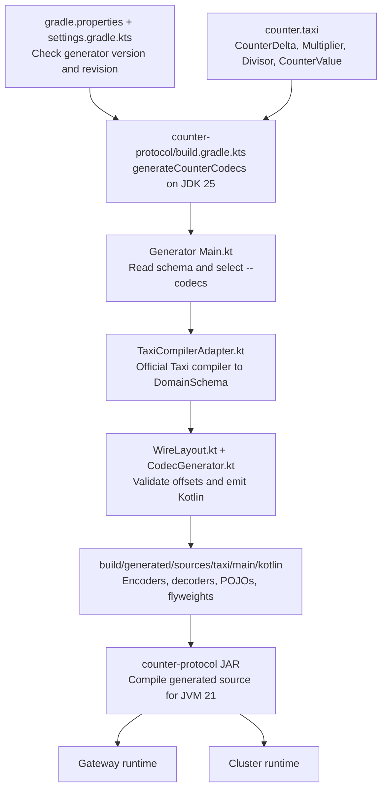
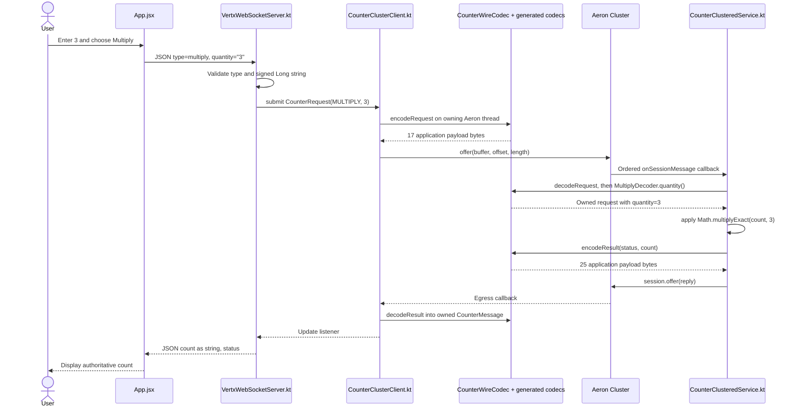
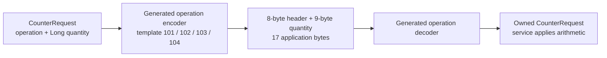
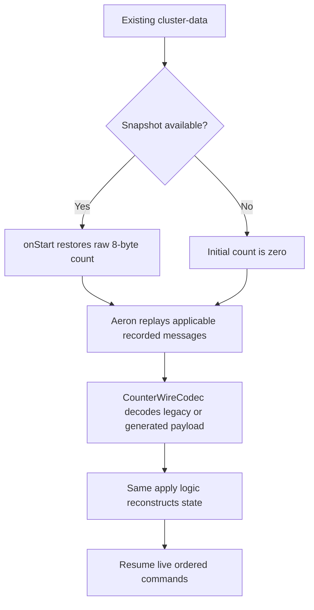

# Taxi x Cluster: code and message flow

These diagrams use Mermaid fences, which GitHub renders directly in Markdown.
The source paths below describe the current implementation; generated files remain
under build/ and are not committed.

## Build time: define the contract once

The generator is a build-time tool. Neither application needs a running Taxi
compiler. `checkCounterSchema` compares the schema with the preserved
`baselines/counter-v0.taxi`; the adapter currently accepts schema version 0 only,
so compatibility checks do not automatically enable a new runtime version.

## Runtime: one Multiply request

For count 20, Multiply(3) returns 60. Add(20), Multiply(3), Subtract(10),
Divide(4) from zero produces 20 -> 60 -> 50 -> 12. Division rounds toward zero;
overflow and division by zero leave state unchanged. Taxi names express meaning;
`CounterClusteredService.apply()` implements the arithmetic rules.

## What is serialized

The header contains four little-endian uint16 fields: block length, template ID,
schema ID, and version. All counter templates use schema 2, version 0.
The full-range quantity/count representation is one tag byte plus int64 raw data:
tag 0 means the raw value, tag 1 plus raw 0 means Long.MIN_VALUE. Generated
CounterResult uses template 105, an 8-byte status and 9-byte count after its header.
Aeron adds its own transport/session framing outside these application payloads.

The live path uses generated encoders and decoders directly; generated POJOs and
flyweights are available but not used by that path. Returned CounterMessage values
own their data; an Aeron callback buffer must not escape through a borrowed view.

## Read the code in order

| File | Job |
| --- | --- |
| [counter.taxi](../backend/counter-protocol/src/main/taxi/counter.taxi) | Shared semantic types, fields, message IDs, and full-range policy. |
| [protocol build](../backend/counter-protocol/build.gradle.kts) | Run the pinned generator, compile output, check the baseline. |
| [App.jsx](../frontend/src/App.jsx) | Validate input with BigInt, send JSON, display replies, reconnect. |
| [VertxWebSocketServer.kt](../backend/trading-gateway/src/main/kotlin/com/example/clusterstatemachine/gateway/VertxWebSocketServer.kt) | Validate browser requests and broadcast on a Vert.x context. |
| [CounterClusterClient.kt](../backend/trading-gateway/src/main/kotlin/com/example/clusterstatemachine/gateway/CounterClusterClient.kt) | Own the queue, Aeron connection, offers, keep-alives, and egress. |
| [CounterWireCodec.kt](../backend/counter-protocol/src/main/kotlin/com/example/clusterstatemachine/protocol/CounterWireCodec.kt) | Dispatch generated codecs and retain legacy formats. |
| [CounterClusteredService.kt](../backend/cluster/src/main/kotlin/com/example/clusterstatemachine/cluster/CounterClusteredService.kt) | Own count, deterministic arithmetic, snapshot callbacks, and replies. |
| [SingleNodeClusterRuntime.kt](../backend/cluster/src/main/kotlin/com/example/clusterstatemachine/cluster/SingleNodeClusterRuntime.kt) | Configure the embedded driver, archive, consensus module, and service container. |

## Recovery is a separate flow

Legacy commands still decode and receive legacy replies. GET remains one byte;
snapshots remain raw 8-byte Longs. Upgrade the service before the gateway; an older
service cannot replay generated commands recorded in the log. The integration
test verifies graceful single-node restart replay; crash recovery, a real snapshot
restart, and multi-node failover remain unverified.

See [IntelliJ launch and debugging](intellij.md) for shared run configurations,
breakpoint locations, and a walkthrough that can be paused without live timeouts.
