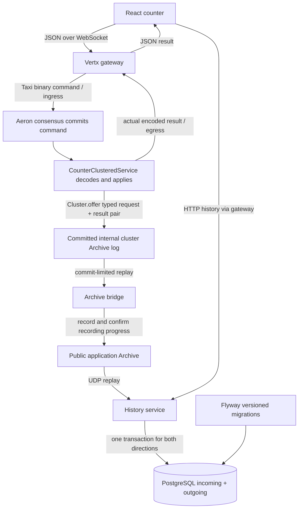

# Run, inspect and debug the history flow

The count stays authoritative in Aeron Cluster. PostgreSQL is an asynchronous,
rebuildable history view. Every admitted command, including GET, legacy commands
and rejected arithmetic, produces a paired request/result record. Browser/gateway
validation failures never enter the cluster and are excluded.



“Public” means a documented consumer-facing recording, on loopback, independent
of the internal recovery recording. It does not mean internet exposure. Outgoing
records describe service-produced replies; they do not prove browser receipt.

## Launch

Prerequisites: JDK 25, Python 3, Node.js/pnpm versions from the root README,
the pinned sibling generator checkout, and running Docker Desktop.

From the repository root:

```sh
python3 scripts/run-local.py
```

On first use the launcher creates a private ignored `.env` with a random database
password. It starts/health-checks PostgreSQL, builds the backend, installs frontend
dependencies, then starts cluster, bridge, history, gateway and frontend in order.
Open <http://127.0.0.1:5173>. The original count controls and the paired history
view are on the same page. Refresh shows newest rows; Older operations uses a
stable source/position cursor. Counts and quantities remain JSON strings.

Ctrl+C stops applications in reverse order and preserves all saved data. PostgreSQL
stays running; stop it separately with `docker compose stop`. IntelliJ's **Run -
complete counter with history** invokes the same ordered launcher. The older
three-component compound remains available for counter-only debugging.

Logs are in `data/logs/`. A failed core application stops the launcher; inspect its
log and restart to resume. If the history service or Archive bridge exits after
startup, the counter remains available and the launcher reports the failure.
Restart the launcher to resume that component from retained data. The database, public recording and cluster
must be preserved together. Read [storage/migration](data-storage.md) before moving
or resetting anything. Existing local runtime trees were backed up under
`data/backups/pre-history-*` before migration.

## Separate terminals / IntelliJ

Start PostgreSQL with `docker compose up -d --wait`. Then run, in order:

```sh
./gradlew :cluster:bootRun
./gradlew :archive-bridge:run
./gradlew :history-service:run
./gradlew :trading-gateway:bootRun
pnpm --dir frontend dev --host 127.0.0.1 --port 5173 --strictPort
```

Each command stays running in its own terminal. Wait for each ready message before
starting the next. Shared IntelliJ configurations: **Cluster - counter service**,
**Archive - public recording bridge**, **History - replay and PostgreSQL**,
**Gateway - WebSocket bridge**, **Frontend - web counter**. Reload the Gradle project
on JDK 25 after adding the new modules. Stop existing launcher processes before
using these configurations, to avoid port/driver conflicts.

The installed IntelliJ Community Edition has no bundled Database Tools plugin.
The SQL console below works immediately; IntelliJ connection instructions for an
edition/plugin with Database Tools are in [storage](data-storage.md).

## Database and Flyway

```sh
docker compose exec postgres psql -U counter -d counter_history
```

Useful SQL:

```sql
SELECT installed_rank, version, description, success FROM flyway_schema_history;
SELECT i.source_id, i.command_position, i.operation, i.quantity,
       i.capture_kind, o.status, o.count
FROM incoming i JOIN outgoing o USING (source_id, command_position)
ORDER BY i.ingested_order DESC LIMIT 20;
```

V1 creates exactly two business tables; Flyway also creates `flyway_schema_history`.
V2 adds capture provenance and separates schema IDs from wire version. V3 keeps
replay progress for each public recording when a pair is re-exported in a new one. The history
service migrates/validates before accepting queries or ingesting. Never edit an
applied migration; add V3, V4, etc. A changed checksum prevents startup. Compose
starts PostgreSQL and preserves its files; it does not maintain the SQL schema.

Default connection: `127.0.0.1:5432`, database `counter_history`, user `counter`,
password in local `.env`. `POSTGRES_PORT` changes the host port. The history service
also accepts `HISTORY_JDBC_URL`, `POSTGRES_USER`, `HISTORY_PORT` (default 8082), and
`APP_DATA_ROOT`. The gateway Spring property `history.url` defaults to
`http://127.0.0.1:8082`. The default full launcher uses ports 8081/8082/5173,
cluster UDP 9001–9005 and public Archive control UDP 9021, all local.

## Code and debugger stops

| Stage | File and overall job | Useful breakpoint |
| --- | --- | --- |
| Web command | `frontend/src/App.jsx` sends JSON; `backend/trading-gateway/.../VertxWebSocketServer.kt` validates/maps it | `handleMessage` |
| Taxi wire | `backend/counter-protocol/.../CounterWireCodec.kt` adapts generated request/result codecs | `encodeRequest`, `decodeRequest`, `encodeResult`, `decodeResult` |
| Ordered state | `backend/cluster/.../CounterClusteredService.kt` applies committed arithmetic and constructs actual result | `onSessionMessage`, creation of `AuditPair`, `cluster.offer` |
| Runtime identity | `backend/cluster/.../SingleNodeClusterRuntime.kt` launches internal driver/Archive/consensus/service and preserves source identity | `sourceId`, `captureStartPosition` setup |
| Audit contract | `backend/counter-protocol/.../AuditPairCodec.kt` bounds-checks the versioned wrapper around exact message bytes | `encode`, `decode` |
| Public recording | `backend/archive-bridge/.../ArchiveBridge.kt` replays only committed log range and confirms actual recording before checkpointing | `exportCommitted`, `record`, `persistCheckpoint` |
| Archive replay | `backend/archive-bridge/.../ArchiveSupport.kt` hosts public Archive and finite IPC/UDP replay | `replayRange` |
| SQL projection | `backend/history-service/.../HistoryReplay.kt` decodes each pair; `HistoryDatabase.kt` inserts both directions transactionally | `catchUp`, `insert`, `connection.commit` |
| Schema startup | `backend/history-service/.../HistoryDatabase.kt` runs Flyway before ingestion; SQL in `src/main/resources/db/migration/` | `Flyway.configure`, `migrate` |
| Queries | `HistoryApplication.kt` serves reads off Vert.x event loops; gateway proxies asynchronously | `database.page`, `sendAsync` |
| History UI | `frontend/src/HistoryPanel.jsx` polls paginated results and displays availability | `load` |

Backend `...` above expands to
`src/main/kotlin/com/example/clusterstatemachine/{gateway,protocol,cluster,archive,history}/`.
Generated arithmetic codecs remain in `backend/counter-protocol/build/generated/sources/taxi/`.
The shared Taxi schema and baseline are unchanged; no Taxi compiler was added to
runtime. The handwritten audit wrapper supports variable raw byte arrays outside
the generator's fixed-field profile.

For an easy database walkthrough: start Docker, select **Debug - history database
walkthrough**, put a breakpoint in `HistoryDatabase.insert`, then click Debug.
The test uses an isolated PostgreSQL schema and removes only that schema afterwards.
Step Over runs the highlighted line; Step Into enters the function; Step Out
returns to its caller. Inspect incoming raw bytes, the decoded operation, outgoing
result, both inserts and the commit/rollback. It does not need a live counter.

For live cluster/bridge debugging use **Suspend: Thread**, keep stops brief and
resume before transport deadlines. Long pauses can trigger Aeron timeouts. Use the
existing serialization walkthrough for long pauses through encoding/arithmetic.

## Recovery contract and limits

Identity is cluster `source-id` UUID plus absolute command log position. The source
UUID and immutable `audit-start-position` live with cluster data. v2 records are
CAPTURED after that boundary and RECONSTRUCTED at/before it. v1 records are
UNCLASSIFIED and must not be represented as previously captured outgoing bytes.

A successful `Cluster.offer` is a recoverable service-message handoff, not proof
that the public recording or SQL is ready. The bridge waits for the cluster commit
position, then waits for public Archive recording position before advancing its
atomic checkpoint. Re-export is allowed after interruption; SQL checks identities
and exact bytes rather than assuming exactly-once transport. Both SQL rows and their per-recording
replay positions commit together. A conflict stops ingestion with an error.

History uses a dedicated ingestion thread and bounded finite replays; SQL never
runs in state transitions or on a Vert.x event-loop thread. HTTP pages are capped
at 100 rows. Bridge offer/recording waits are limited to 10 seconds and finite
replays to 30 seconds. Database outages pause ingestion while the counter and
bridge can continue within available disk resources. History retries retained data.
The displayed caught-up state refers to public recordings, not an atomic position
across cluster, Archive and SQL.

No automatic retention deletion is enabled: monitor `data/` disk usage. Keep all
source logs needed by the bridge and all public recordings needed to rebuild SQL.
A count snapshot cannot recreate missing historical messages. Do not independently
reset a public Archive while retaining SQL replay positions, or replace source
identity while retaining the same cluster log. Normal Gradle clean preserves data.

## Local verification on 23 October

The complete launcher was exercised against the migrated local counter: count 45
was preserved. PostgreSQL was stopped while Add 0 was submitted: the counter still
replied, the public Archive recorded it, and history queries returned unavailable.
After PostgreSQL restarted, history caught up with matching incoming/outgoing rows.
The launcher was then stopped gracefully; all five application processes released
their ports and persistent data remained intact. Add 0 checks preserved the count.

## Verification

With Docker/PostgreSQL healthy:

```sh
./gradlew build :cluster:integrationTest :history-service:integrationTest
pnpm --dir frontend format:check
pnpm --dir frontend build
```

Integration tests use temporary Archive/cluster directories and isolated PostgreSQL
schemas; they never reset the normal counter or business tables. They cover
legacy/generated replay, paired public recording, duplicate re-export, SQL rollback,
checksum failure, Long boundaries, pagination, separate-driver UDP ingestion,
disposable database rebuild, process interruption before/after service publication,
and real snapshot/restart. This remains a single-member learning application;
multi-node failover and power-loss durability have not been verified.
